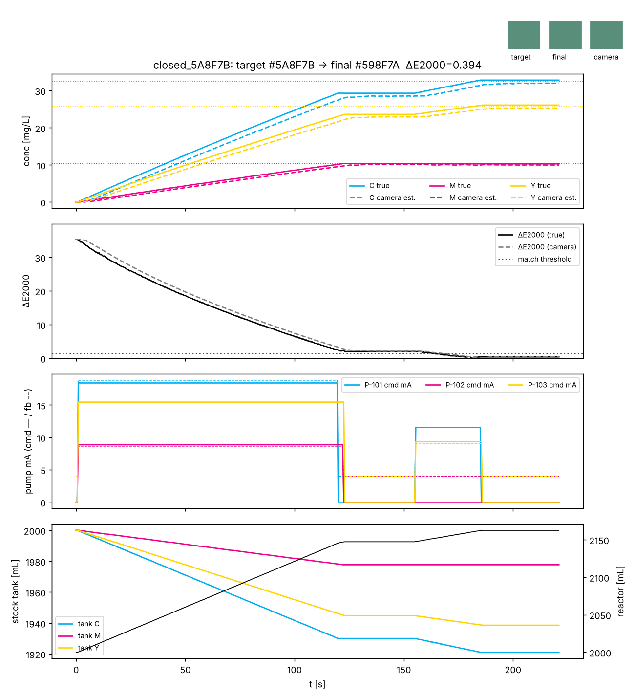

# coprecip_sim — CMY 식용색소 도징 · target color 매칭 시뮬레이터

전구체 공침 반응기 실험의 1단계(식용색소 실험)를 보드 없이 통째로 돌려 보는 코드입니다.
시안·마젠타·옐로 스톡을 gamma/X 펌프 3대로 반응기에 넣어 **목표색을 만들고**, 펌프 유량(=흘려주는 색소 양)을
바꿔 가며 **목표색에 얼마나 가까워지는지(ΔE2000)** 를 카메라 모델로 비교합니다. 제어 구조는 실제 하드웨어
(Pi 5 + AI HAT+ ↔ Pi 5 + MCC 118/134/152×2, 이더넷)와 같게 두 노드로 나눠 놓았습니다.

```
AI 노드 (Pi 5 + AI HAT+, RealSense)              I/O 노드 (Pi 5 + MCC 118 + MCC 134 + MCC 152 ×2)
┌──────────────────────────────┐   cmd (JSON)   ┌────────────────────────────────────────────────┐
│ 카메라 ROI RGB → 흡광도      │ ─────────────▶ │ 인터록 · 운전허가 · 밸브 · 펌프 mA · 스트로크 계수 │
│ → NNLS 로 ĉ(C,M,Y)           │   telemetry    │ MCC 152 AO → XTR111 → 4–20 mA → gamma/X          │
│ 레시피 계획 / 피드포워드 /   │ ◀───────────── │ MCC 118: 펌프 피드백(옵션 C)·pH·압력, MCC 134: 온도│
│ 카메라 폐루프 트림           │   하트비트     │ 하트비트 1 s 끊기면 SAFE (Pause → 0 mA → 밸브 닫힘) │
└──────────────────────────────┘                └────────────────────────────────────────────────┘
                                                          │ 스톡 C/M/Y (2 L, 1 g/L)  →  반응기 5 L (heel 2 L)
```

## 빠른 시작

```bash
cd coprecip_sim
python -m cmysim plan  --target "#5A8F7B"                       # 투입량·유량·mA 계획만
python -m cmysim run   --target "#5A8F7B" --mode closed --plot run.png --csv run.csv --dataset ds/
python -m cmysim run   --target "#5A8F7B" --mode open  --fault stock_conc:P-101=900 --e-cal-err 0.03
python -m cmysim sweep --target "#5A8F7B" --factors 0.7,0.85,1,1.15,1.3 --csv sweep.csv
python -m cmysim calib                                           # MCC 152 이득오차 2점 교정 시연
python -m pytest -q tests                                        # 10개 테스트
```

필요한 것: Python 3.10+, numpy. 그래프는 matplotlib(선택). 목표는 `--target '#RRGGBB'` 또는 `--cmy 30,10,25`(mg/L).

## 무엇을 시뮬레이션하나

| 층 | 모듈 | 모델 |
|---|---|---|
| 광학 | `optics.py` | PDF 보고서 7장 절차 그대로: 감마 제거 → 흡광도 A = −log10(I/I0) → A = E c (3×3) → 비음수 최소제곱. 색차는 CIEDE2000/ΔE76 |
| 펌프 | `hardware.py` | gamma/X Analog 모드: 4.4 mA 첫 스트로크, 19.6 mA 200 spm, 3.8 mA 아래 신호 알람, 1 스트로크 = 0.19 mL × 스트로크 길이 × (1 ± 1 %), 옵션 C 피드백 4–20 mA, 수위 입력, 토출 막힘 시 릴리프 3 bar |
| DAC 체인 | `hardware.py` | MCC 152 AO 12 bit 0–5 V(이득오차 ±1.5 %) → XTR111 4.016 mA/V, OD 핀 페일세이프, 2점 교정 |
| 계측 | `hardware.py` | MCC 118 12 bit ±10 V + 250 Ω 션트, MCC 134 열전대 잡음 |
| 공정 | `process.py` | 스톡 탱크 잔량·수위 스위치, 반응기 물질수지(semi-batch), 교반 혼합 지연 t_m = 3000/rpm [s] |
| 비전 | `vision.py` | RealSense 대역 합성 프레임(비네팅·잡음·기포), ROI 평균, YOLO 라벨 데이터셋 기록 |
| 노드 | `nodes.py` | Bus(ZeroMQ 대역), HAL(SimHAL / DaqHatsHAL), IONode(인터록·워치독·스트로크 계수 도징), AINode |
| 제어 | `control.py` | 계획: V_f = V_heel/(1 − Σc_j/c_s), V_j = c_j V_f / c_s. 상태기계 PLAN→PRIME→DOSE→SETTLE→MEASURE→TRIM→DONE |
| 실행 | `experiment.py` | 고장 주입, 유량 스윕, 그래프, CSV/JSON, 데이터셋 |

## 실험 1: 유량(투입량)을 바꾸면 색이 얼마나 비껴가나 (`sweep`)

같은 도징 시간에 펌프 하나의 유량만 ×0.7~×1.3 으로 바꾼 결과(목표 #5A8F7B, 개루프, 매칭 기준 ΔE2000 < 1.5):

| 펌프(염료) | ×0.7 | ×0.85 | ×1.0 | ×1.15 | ×1.3 |
|---|---|---|---|---|---|
| P-101 (C) | 6.6 | 2.6 | 0.0 | 2.4 | 4.4 |
| P-102 (M) | 5.5 | 3.0 | 0.0 | 3.0 | 5.4 |
| P-103 (Y) | 9.3 | 4.4 | 0.0 | 3.5 | 6.1 |

유량 15 % 오차면 이미 ΔE 2~4 로 육안 식별 수준입니다. 옐로(황색 4호 역할)가 가장 민감한데, 이 색에서 Y 농도가
B 채널 흡광도를 거의 혼자 정하기 때문입니다. 이 표가 "펌프 교정·스톡 농도 관리가 얼마나 정확해야 하는가"의 답입니다.

## 실험 2: 개루프 vs 카메라 폐루프 (`run --mode open|closed`)

스톡이 라벨보다 묽고(C 900, Y 920 mg/L) AI 노드의 보정 행렬 E 에 3 % 오차가 있을 때:

| | 최종 ΔE2000 | 트림 | 비고 |
|---|---|---|---|
| open (피드포워드만) | 2.0 | – | 계획대로 넣었지만 스톡 오차만큼 빗나감 |
| closed (카메라 트림) | 0.4 | 1회 | 카메라 추정 ĉ 와 목표 차이만큼 추가 투입 (C +8.9 mL, Y +6.2 mL) |



폐루프는 **부족분만 메울 수 있습니다.** 오버슈트는 물 펌프가 없으면 못 돌리므로, 피드포워드는 일부러 약간 적게
넣도록 `flow_factor`(예 0.97)를 쓰는 것이 실제 운용에서 안전합니다.

## 실험 3: 고장 주입 (`--fault`)

| 지정 | 무엇이 일어나나 | 코드가 어떻게 잡나 |
|---|---|---|
| `tank_empty:P-101@30` | 30 s 에 C 스톡이 수위 스위치 직전까지 줄어듦 → 펌프 수위 입력으로 자체 정지 | I/O 노드 `NO_STROKE` 알람(지령 18 mA, 피드백 4 mA), AI 노드 DOSE 타임아웃 → 중단 |
| `valve_stuck:XV-101` | 코일은 켜지는데 밸브가 안 열림 → 데드헤드 | 릴리프 3 bar 로 탱크 복귀(반응기엔 안 들어감). 압력 트랜스미터가 2.7 bar 넘기면 I/O 노드가 도징 펌프 전부 정지 + `RELIEF` 알람 |
| `signal_loss:P-103@40` | 4–20 mA 케이블 단선 | 펌프가 0 mA 를 보고 정지, `NO_STROKE` |
| `ai_crash@150` | AI 노드 프로세스 사망(하트비트 중단) | I/O 노드 워치독 1 s → SAFE(Pause → 0 mA → 밸브 닫힘) |
| `camera_drift:0.9@60` | 조명/노출 10 % 변화 | 실제 농도는 맞는데 ĉ 가 전부 커 보여 카메라 ΔE 2.4 로 '불일치' 판정, 트림도 못 함(= 수동 노출 고정과 기준 영상 I0 재촬영이 왜 필수인지) |
| `stock_conc:P-101=900` | 칭량 오차 | open 은 빗나가고 closed 는 트림으로 복구 |
| `rpm:80` | 교반 약함 → 혼합시간 37 s | SETTLE 이 길어지고 카메라 추정이 뒤처짐 |

## 데이터셋 (`--dataset DIR`)

2 s 마다 합성 프레임 PNG + YOLO 라벨(`0 on_target` / `1 off_target`, 액체 ROI 박스)과 `index.jsonl`(진짜 농도, 추정 농도,
RGB, ΔE)을 남깁니다. `dataset.yaml` 은 Ultralytics 형식입니다. 나중에 RealSense 실제 프레임으로 바꿔도 라벨 형식은 그대로
쓰면 됩니다. 단, 색·농도 같은 연속값은 YOLO(탐지)보다 `index.jsonl` 로 회귀 모델을 학습하는 쪽이 맞고, YOLO 는
기포·와류·침전·이물 같은 '사건' 탐지에 쓰는 것이 대화에서 정리한 역할 분담입니다.

## 라즈베리파이에서 실행 (실제 카메라)

### 설치 (AI 노드: Pi 5 + AI HAT+, Raspberry Pi OS 64-bit Bookworm)

```bash
sudo apt install -y python3-numpy python3-opencv python3-zmq python3-picamera2
pip install pyrealsense2        # aarch64 휠이 없으면 librealsense 를 소스 빌드해야 합니다 (아래 링크)
```

RealSense 는 USB 3.0 포트(파란색)에 꽂고 `rs-enumerate-devices` 로 인식을 확인합니다. pyrealsense2 가 Pi 에서 바로
안 깔리면 https://github.com/IntelRealSense/librealsense/blob/master/doc/installation_raspbian.md 를 따라 빌드하거나,
임시로 `--kind opencv` 로 RealSense 를 UVC 웹캠처럼 열어 색만 읽을 수 있습니다. 라즈베리파이 전용 카메라를 사면
`--kind picamera2` 로 바꾸면 됩니다(인터페이스 동일).

두 Pi 는 이더넷 직결 + 고정 IP(예 I/O 192.168.10.2, AI 192.168.10.3)로 둡니다. I/O 노드 설치는 아래 절을 보세요.

### I/O 노드 (Pi 5 + MCC 152 ×2 + MCC 118 + MCC 134)

```bash
sudo apt install -y git python3-pip python3-numpy python3-zmq
git clone https://github.com/mccdaq/daqhats && cd daqhats && sudo ./install.sh      # MCC daqhats 라이브러리 + 파이썬 모듈
daqhats_list_boards                                                                  # 주소 0,1 = MCC 152, 2 = MCC 118, 3 = MCC 134
```

주소는 보드의 A0~A2 점퍼로 정합니다(점퍼 없음 = 0, A0 = 1, A1 = 2, A0+A1 = 3). 다른 주소를 썼으면
`python -m cmysim.io_node_main init-config` 로 만든 `io_node.json` 의 `addresses` 와 핀 배정을 고치면 됩니다.
24 V 전원은 Pi 와 보드가 켜진 뒤에 넣습니다.

빵판 단계(24 V 없이, 대화의 `mcc152_bench.py` 와 같은 점검):

```bash
cd coprecip_sim
python -m cmysim.io_node_main list                       # 보드 인식
python -m cmysim.io_node_main bench ramp 0               # AO0 0→5 V 계단, 멀티미터로 확인
python -m cmysim.io_node_main bench dio 4 1              # DIO4 LED 켜기
python -m cmysim.io_node_main bench blink 5              # DIO5 깜빡임 (PC817)
python -m cmysim.io_node_main bench read                 # EF 핀·아날로그 입력·온도 연속 표시 (32번 줄 GND 시험)
```

펌프 인터페이스 보드(XTR111)와 24 V 를 붙인 뒤:

```bash
python -m cmysim.io_node_main bench pump P-101 12        # OD 켜고 12 mA, 피드백·EF 표시 (펌프는 Pause 상태로)
python -m cmysim.io_node_main bench calib P-101          # 멀티미터 값으로 2점 교정 → io_node.json (MCC 152 이득오차 ±1.5 % 보정)
python -m cmysim.io_node_main run -v                     # 본 운전: 10 Hz, ZeroMQ PULL 5555 / PUB 5556
```

`run` 중 I/O 노드가 스스로 하는 일: 밸브 닫힌 채 펌프 지령 거부, 운전허가 없이 펌프 거부, 압력 2.7 bar 초과 시 도징 펌프 정지,
AI 노드 하트비트 1 s 끊기면 SAFE, 지령은 있는데 스트로크 피드백이 없으면 `NO_STROKE`, XTR111 EF 핀 Low 면 `EF` 알람.
프로세스가 어떤 이유로 끝나도 `finally` 에서 RUN_ENABLE OFF → AO 0 V → OD High → 밸브 OFF 를 수행합니다.

보드 없이 두 Pi(또는 PC 두 대)의 이더넷·ZeroMQ 연동만 시험하려면 I/O 쪽을 `run --sim` 으로 띄우면 됩니다.
시뮬레이션 공정이 실제 I/O 노드처럼 텔레메트리를 내고 명령을 받습니다.

### 카메라 보정 순서 (PDF 8장 절차를 그대로 명령으로)

```bash
cd coprecip_sim
python -m cmysim.camera_tools settings --kind realsense --exposure 120 --gain 16 --wb 4600   # 수동 고정
python -m cmysim.camera_tools preview --save shot.png        # ROI 가 액체 안에 들어가는지 확인
python -m cmysim.camera_tools roi --roi 220,140,200,200       # 또는 --pick (모니터 있을 때 마우스로)
python -m cmysim.camera_tools reference                       # 물만 채운 반응기 → 픽셀별 기준 I0
python -m cmysim.camera_tools sample --dye C --conc 5         # 시안 5 mg/L … 10, 15, 20 (염료마다 4~5점)
python -m cmysim.camera_tools sample --dye M --conc 5
python -m cmysim.camera_tools sample --dye Y --conc 5
python -m cmysim.camera_tools fit                             # E 피팅 → calibration.json (조건수·R² 출력)
python -m cmysim.camera_tools check --cmy 10,5,8              # 보정에 안 쓴 혼합액으로 검증
python -m cmysim.camera_tools target --save target.json       # 목표 시료(기준 색 용액)를 같은 카메라로 촬영
```

카메라가 없는 워크스테이션에서는 `settings --kind fake` 로 위 명령을 전부 돌려 볼 수 있습니다
(`CMYSIM_FAKE_CONC=10,5,8` 환경변수로 가짜 액체 농도를 바꿉니다).

`reference` 에서 I0 가 0.95 를 넘으면 포화이니 노출을 줄이고, `sample` 에서 흡광도가 1 을 넘으면 더 묽게 잡습니다.
조명·카메라 위치·노출을 바꾸면 reference 부터 다시 합니다.

### 실험 실행

```bash
python -m cmysim.camera_tools monitor --target "#5A8F7B"      # 배선 전: 카메라만으로 ĉ, ΔE 확인
python -m cmysim.ai_node_main --io-ip 192.168.10.2 --target-file target.json --mode closed \
       --flow-factor 0.97,0.97,0.97 --log run1.csv --dataset ds_run1/ --preview
```

목표는 `--target '#hex'`, `--cmy`, `--target-file` 중 하나로 줍니다. ΔE 기준으로는 같은 카메라·조명으로 찍은
`target.json` 이 가장 정확합니다(hex 는 모델을 거쳐 환산되므로 비네팅·글레어만큼 어긋날 수 있음).

`ai_node_main` 은 시뮬레이터와 같은 `Controller` 를 쓰고 카메라 입력만 실물입니다. Ctrl+C·예외·완료 어느 경우에도
I/O 노드에 `run_enable OFF` 와 `safe` 를 보내고, I/O 노드는 하트비트가 1 초 끊기면 스스로 SAFE 가 됩니다.
`--dataset` 을 주면 실제 프레임이 2 초마다 YOLO 라벨과 함께 저장됩니다(라벨의 c_true 는 실물에서는 null, 카메라 추정 ĉ 와 ΔE 만 기록).

## 레시피 실행기 (`recipe.py`, `recipe_cli.py`)

실험 절차를 YAML 로 적으면 그대로 도징 순서가 됩니다. 시뮬레이터와 실제 AI 노드 양쪽에서 `Controller` 자리에 끼워 씁니다.

```yaml
name: target_match
reactor: {heel_mL: 2000, rpm: 300}
stocks: {C: 1000, M: 1000, Y: 1000}
target: {hex: "#5A8F7B"}            # 또는 {cmy: [30, 10, 25]} / {file: target.json}
match: {de: 1.5, max_trims: 3}
steps:
  - {step: stir, rpm: 300}
  - {step: dose_to_target, minutes: 2, flow_factor: [0.97, 0.97, 0.97]}
  - {step: settle, factor: 3}
  - {step: measure, label: feedforward}
  - {step: trim_to_target, max_trims: 3}
  - {step: hold, seconds: 30, label: final}
  - {step: stop}
matrix: {"reactor.rpm": [150, 300, 500]}   # 선택: 카르테시안 곱으로 실행 묶음 생성
```

| 스텝 | 인자 | 하는 일 |
|---|---|---|
| `stir` | rpm | 교반기 지령 |
| `wait` / `hold` | seconds, label | 대기. hold 는 끝에 측정을 기록 |
| `dose` | pump 또는 pumps, volume_mL / strokes / total_mL(+ratio), rate_mL_min / minutes / mA, on_abort | 명시 투입. 밸브 열기 → 스트로크 계수 도징 → 밸브 닫기 |
| `dose_to_target` | minutes, flow_factor | 목표 농도에서 투입량을 계산해 세 펌프 동시 투입 |
| `settle` | factor 또는 seconds | 혼합시간 × factor 만큼 대기 |
| `measure` | seconds, label | 카메라 평균 → RGB·ĉ·ΔE 기록 |
| `trim_to_target` | max_trims, tol_mg_L, de | 부족분 계산 → 투입 → 정착 → 측정 반복 |
| `inject_fault` | kind, arg, seconds | 시뮬레이션: 고장 주입 + 라벨. 실물: 사람이 수행할 내용을 출력하고 대기 |
| `valve` / `log` / `stop` | | 밸브 수동 조작, 메모, 종료(운전 허가 OFF + SAFE) |

```bash
python -m cmysim.recipe_cli example > my.yaml
python -m cmysim.recipe_cli validate my.yaml
python -m cmysim.recipe_cli run recipes/tierA_ratio_sweep.yaml --out results --plot    # matrix 9개 실행 + summary.csv
python -m cmysim.ai_node_main --io-ip 192.168.10.2 --recipe recipes/target_match.yaml    # 실물 (matrix 면 첫 항목)
```

`recipes/` 에 세 가지 예시가 있습니다. `target_match.yaml`(목표색 매칭), `tierA_ratio_sweep.yaml`(비율 × rpm 매트릭스,
대화의 Tier A 혼합 실험), `fault_injection.yaml`(이상탐지 라벨용 고장 주입). 모든 스텝 전이·측정·고장은 `log.json` 에
시간과 함께 남아 이상탐지 학습의 라벨이 됩니다. 인터록(밸브 닫힌 채 펌프 금지 등)은 레시피가 아니라 I/O 노드가 지킵니다.

## YOLO 학습 (`yolo_train.py`)

역할 분담은 대화에서 정리한 대로입니다. 색 → 농도 같은 연속값은 Beer–Lambert 역산(또는 작은 회귀)이 맡고,
YOLO 는 기포·거품·침전·이물 같은 '사건' 과 액체 ROI 의 on/off_target 상태를 봅니다.

라벨 클래스: `0 liquid_on_target`, `1 liquid_off_target`(ΔE2000 기준), `2 bubble`.
시뮬레이션 프레임은 기포 위치를 알고 그리므로 자동 라벨이 붙고, 실제 프레임은 ROI 박스만 자동이며 기포 박스는
CVAT/LabelImg 로 추가합니다(같은 YOLO txt 형식).

```bash
cd coprecip_sim
python -m cmysim.yolo_train gen --out ds_sim --runs 12                  # 시뮬레이션 12회 → 라벨 달린 프레임
python -m cmysim.yolo_train prepare --src ds_sim/* ds_run1 --out yolo_ds # 실행 단위 train/val 분할, data.yaml, regression.csv
python -m cmysim.yolo_train train --data yolo_ds/data.yaml --model yolo11n.pt --epochs 50 --imgsz 320 --device 0
python -m cmysim.yolo_train train --data yolo_ds_cls --task classify --model yolo11n-cls.pt --epochs 30
python -m cmysim.yolo_train infer --weights runs/detect/cmy/weights/best.pt --source yolo_ds/images/val --save pred/
python -m cmysim.yolo_train export --weights runs/detect/cmy/weights/best.pt    # ONNX (NMS 없음, 고정 크기) → Hailo 컴파일
python -m cmysim.yolo_train regress --csv yolo_ds/regression.csv         # 색→농도 회귀 (optics 역산과 비교)
```

- **분할은 실행 단위**가 기본입니다. 같은 실행의 연속 프레임이 train/val 에 섞이면 점수가 부풀려집니다.
- **색상 증강(hsv_h, hsv_s)은 꺼져 있습니다.** 색이 라벨 그 자체이기 때문입니다.
- 학습은 워크스테이션에서 합니다. Pi 에서는 추론만 합니다(`.pt` 는 CPU 로 수 fps, AI HAT+ 는 `.hef`).
- **Hailo 경로**: `export` 가 만든 ONNX 를 x86 에서 Hailo Dataflow Compiler(`hailomz compile`, 보정 이미지 = `yolo_ds/images/train`)로
  `.hef` 로 바꾸고 AI 노드로 복사합니다. `yolo_infer.VisionEvents` 가 `.pt/.onnx`(ultralytics) 와 `.hef`(hailo_platform) 를 같은
  인터페이스로 감쌉니다. `.hef` 후처리는 hailo_model_zoo 의 YOLO NMS 출력 형식을 가정했고 Pi 에서 검증이 필요합니다.
- AI 노드에 붙이기: `ai_node_main --yolo best.pt --yolo-every 5`. 액체 상태·기포 수가 로그에 남고, 기포가 `--bubble-hold`
  개 이상이면 MEASURE 구간을 연장해 기포가 가라앉은 뒤 트림을 판단합니다.
- `regress` 는 numpy 만으로 ROI RGB → 농도 릿지 회귀를 학습합니다. 시뮬레이션에서는 optics 역산과 비슷한 0.3~0.4 mg/L 수준이며,
  실제 장치에서 Beer–Lambert 선형 가정이 깨지는 짙은 농도 구간의 보정 곡선으로 쓸 수 있습니다.

## 실제 보드로 옮길 때

1. `daqhats_hal.DaqHatsHAL` 이 `io_node.json` 의 주소·핀 배정대로 daqhats 를 호출합니다. 실제 보드로는 실행하지 못했고,
   `tests/fake_daqhats.py` 로 핀 배정·안전 순서·루프백 도징을 검증했습니다. Pi 에서는 `io_node_main bench` 로 핀을 먼저 확인하세요.
2. `zmq_bridge.ZmqBus` 가 `Bus` 와 같은 인터페이스로 PUSH/PULL + PUB/SUB 를 제공합니다. I/O 노드: `python -m cmysim.zmq_bridge io`.
3. AI 노드는 `cmysim/ai_node_main.py` 가 완성본입니다. `camera.py` 의 RealSense/Picamera2/OpenCV 백엔드가 ROI 평균 RGB 와
   픽셀별 기준 영상 기반 흡광도를 `Controller.step(..., A=A)` 에 넣습니다.
4. 보정 행렬 E 와 I0 는 `camera_tools` 로 실측해 `calibration.json` 에 저장되고 `ai_node_main` 이 자동으로 읽습니다.
   `config.py` 의 값은 시뮬레이션용 설명값입니다.

## 가정과 출처

| 항목 | 값 | 근거 |
|---|---|---|
| 펌프 스트로크 | 0.19 mL (GMXa 1602), 최대 200 spm, ±1 % | gamma/X 매뉴얼 (대화에서 확인). 실제 모델명은 명판 확인 필요 |
| mA 곡선 | 4.4 mA 시작, 19.6 mA 최고, <3.8 mA 알람 | gamma/X 매뉴얼 |
| Pause 중 저전류 알람 무시 | 가정 | 펌프 메뉴의 신호 이상 처리 설정에 따라 다름 — 확인 항목 |
| MCC 152 | 12 bit 0–5 V, 이득 ±1.5 % | Digilent 전기 사양 |
| XTR111 | 4.016 mA/V (RSET 2.49 kΩ) | 대화의 보드 설계 |
| 반응기 | 5 L, heel 2 L | 설계 가이드에서 5 L 로 확정 |
| 스톡 | 2 L GL45, 1.00 g/L | 대화의 구매 목록·스톡 농도 제안 |
| 혼합시간 | t_m = 3000/rpm s | 가정 (300 rpm 에서 10 s). 실측으로 바꿀 것 |
| E 행렬, I0, 글레어 | 설명용 값 | PDF 보고서의 가상 예와 같은 성격. 조건수 κ = 1.57 |
| 교반기 | 4–20 mA ↔ 0–1000 rpm | 가정. 교반기 외부 입력 사양 확인 필요 |
| 카메라 | 감마 2.2, ROI 4000 픽셀, 픽셀 잡음 2 % | PDF 보고서 가정 + 일반적 값 |

## 파일

```
coprecip_sim/
├── cmysim/            시뮬레이션: config, optics, hardware, process, vision, nodes, control, experiment, __main__
│                      실물(Pi): camera, camera_tools, ai_node_main (AI 노드) / daqhats_hal, io_node_main (I/O 노드) / zmq_bridge
│                      학습: yolo_train (gen/prepare/train/export/infer/regress), yolo_infer (VisionEvents: .pt/.onnx/.hef)
│                      레시피: recipe (YAML → 스텝 실행기), recipe_cli (example/validate/expand/run)
├── recipes/           예시 레시피 3개
├── tests/fake_daqhats.py  PC 에서 I/O 노드 코드를 시험하는 가짜 daqhats
├── tests/test_sim.py  물질수지·광학 역산·펌프 곡선·DAC 교정·인터록·워치독·폐루프·고장 테스트
├── docs/              예시 그래프
└── README.md
```
