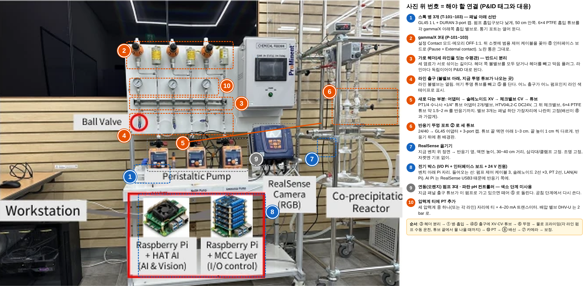

# 현장 연결 — 사진 위 번호대로 (P&ID 태그 ↔ 실물)

P&ID([P_AND_ID.svg](P_AND_ID.svg))의 각 태그가 실물 어디에 붙는지, 그리고 지금 상태에서 무엇을 바꿔야 하는지를 번호로 적었다.

| # | 위치 | 할 일 | P&ID 태그 |
|---|---|---|---|
| ① | 패널 아래 선반 | GL45 1 L 병 3개 + DURAN 3-port 캡. 펌프 흡입구보다 낮게. 6×4 PTFE 흡입 튜브 → 각 gamma/X 흡입 밸브(펌프 헤드 아래). 통기 포트 열어 둠 | T-101~103 |
| ② | 패널 위 펌프 3대 | Contact 모드, 메모리 OFF, 1:1, 스트로크 100 %. 뒤 소켓에 범용 제어 케이블 → ⑧ (Pause, External contact) | P-101~103 |
| ③ | 세 라인을 잇는 가로 헤더 | **분리**. 헤더 쪽 볼밸브 전부 닫거나 헤더를 빼고 플러그. 라인이 서로 통하면 염료가 섞이고 배압이 옆 라인으로 간다 | (P&ID 에 없음 = 없어야 함) |
| ④ | 볼밸브 아래 라인 출구 | 라인 볼밸브 열림. 지금 꽂힌 투명 튜브를 빼고 ⑤ 연결. 라인마다 색 테이프 | HV-10n |
| ⑤ | 새로 설치 | 출구 → PT1/4×1/4" 튜브 어댑터 → HTV04L2-C(DC24V) → 어댑터 → 체크밸브 → 6×4 PTFE 튜브 1.5~2 m → 반응기. 밸브 3개는 패널 하단 가장자리에 고정 | XV-10n, CV-10n |
| ⑥ | 반응기 뚜껑 | 24/40 → GL45 어댑터 + 3-port 캡에 세 튜브. 끝은 액면 아래 1~3 cm, 1 cm 씩 단차. 뒤에 흰 배경판 | R-101 포트 ② |
| ⑦ | RealSense | 벤치 정면 → 반응기 옆, 액면 높이, 30~40 cm, 클램프 고정. 조명 고정. 자켓에 기포 없이 | AE-101 |
| ⑧ | 벤치 아래 | I/O Pi + 인터페이스 보드 + 24 V 전원 박스. 펌프 케이블 3, 솔레노이드 ×3, PT, LAN. AI Pi 는 반응기 쪽(USB3 2 m 안) | I/O 노드 |
| ⑨ | 오렌지 연동 펌프 3대, 파란 pH 컨트롤러 | 색소 단계 미사용. 패널 출구 튜브가 여기로 가 있으면 떼어 ⑤ 로 | (공침 단계) |
| ⑩ | 압력계 티 | 압력계 자리(또는 티 추가)에 4–20 mA 트랜스미터. DHV-U 배압 2 bar | PT-10n, PCV-10n |

## 순서
③ 헤더 분리 → ① 병·흡입 → ④⑤ 출구에 XV·CV·튜브 → ⑥ 뚜껑 → **물로 프라이밍**(각 라인 펌프 수동 운전, 튜브 끝에서 물이 나올 때까지; 이후 튜브는 늘 차 있어야 스트로크 계수 투입이 맞음) → ⑩ PT → ⑧ 배선([WIRING.md](WIRING.md)) → ⑦ 카메라 → 보정([CAMERA_CALIBRATION.md](CAMERA_CALIBRATION.md)).

## 부품 (⑤ 기준, 라인 3개)

그림으로 보려면 [PARTS_LINE.svg](PARTS_LINE.svg) — 한 라인의 모든 부품과 이음새 규격, 제품 사진, 부품표.
- PT1/4 수나사 × 1/4" 튜브 S-LOK 커넥터 ×6 (밸브 양쪽) — 반응기 쪽을 6 mm 튜브로 가려면 출구 쪽은 PT1/4 × 6 mm 커넥터
- HTV04L2-C DC24V ×3, 체크밸브(1/4" 또는 6 mm, 크래킹 압력 낮은 것) ×3
- PTFE 튜브 6×4 mm 10 m, GL45 3-port 캡 ×4, 24/40 → GL45 어댑터 ×1
- 튜브 고정용 케이블 타이·클립, 라인 색 테이프(파랑/자주/노랑)

## 현장에서 확인할 것
- 가로 헤더의 역할(세척용인지 합류용인지)과 그 볼밸브 위치
- 패널 출구 피팅 규격(1/4" 튜브인지 PT 나사인지) — 어댑터 선택이 달라짐
- gamma/X 외부제어 케이블 핀 배정, 압력 트랜스미터 범위
